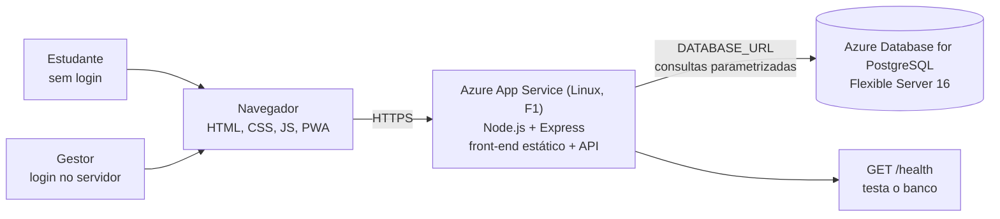

# Avalie o Atendimento

### Cloud Challenge — Grupo 1 | SENAC 2026.2

**Disciplina:** Cloud Computing · **Professor:** Roni Maciel · **Desafio:** 13, Avalie o Atendimento (intermediária)
**Repositório:** https://github.com/mbalbuquerque/avaliacao-de-atendimento
**Aplicação publicada:** https://app-cloud-g01-en.azurewebsites.net
**Código do grupo:** `G01` (a palavra do dia, `G01-PALAVRA`, é anunciada pelo professor)

## 1. Problema e usuário

A unidade quer medir a satisfação com a secretaria, a biblioteca, a cantina e os laboratórios, mas hoje
só existe uma caixa de sugestões de papel que ninguém tabula. O **Avalie o Atendimento** deixa o estudante
avaliar um serviço de forma anônima (nota de 1 a 5 e comentário opcional) e mostra ao gestor médias
confiáveis por serviço: serviços com menos de 3 avaliações aparecem como "amostra insuficiente", em vez de
uma média enganosa. O gestor pode ocultar comentários impróprios sem alterar as notas.

**Usuários:** estudantes (avaliam, sem login) e gestores (consultam os indicadores e moderam).

## 2. Situação atual (18/11/2026)

| Item | Situação |
|---|---|
| API, regras de negócio e validação no servidor | **Implementadas e testadas** |
| Testes automatizados | **70 testes passando** (30 de API e regras, 20 de segurança, 6 de log, 9 de cabeçalhos e CSP, 5 de XSS), com **98,24% de linhas e 93,13% de ramos** cobertos em `src/` (medido em 18/11/2026; o CI exige no mínimo 90% e 80%) |
| Banco PostgreSQL: tabelas, restrições, serviços iniciais e 20 avaliações fictícias | **Implementado** (`banco/schema.sql`, `banco/dados-iniciais.sql`, `banco/permissoes.sql`) |
| `GET /health` com teste real do banco | **Implementado e testado** |
| Moderação do gestor com autenticação no servidor | **Implementada e testada** (cookie `HttpOnly`, `SameSite=Strict`, `Secure`) |
| Painel (formulário, dashboard, tela do gestor) integrado à API | **Concluído**; o modo demonstração e todo o `localStorage` de avaliações foram **removidos** (#15) |
| Implantação na Azure (Nível A) | **Implantado** em https://app-cloud-g01-en.azurewebsites.net (App Service Linux F1, Node 22 LTS, e PostgreSQL 16 Flexible Server B1ms, Brazil South); `/health` responde 200 com `database: connected`; HTTPS obrigatório; usuário do banco da aplicação com privilégios mínimos |
| CI (lint, testes com cobertura, PostgreSQL 16 real, auditoria, CodeQL, Gitleaks, ZAP semanal) | **Em funcionamento** (seção 8) |
| CD (deploy automático) | **Workflow pronto, mas desligado**: falta cadastrar o segredo `AZURE_WEBAPP_PUBLISH_PROFILE`, que só um administrador do repositório consegue (#18). O deploy atual foi feito manualmente |
| Cabeçalhos de segurança (CSP restritiva, HSTS, anti-clickjacking, COOP/CORP/COEP, Permissions-Policy), limite geral de requisições e Chart.js local | **Aplicados** (#14), com testes que leem o HTML e o JavaScript do front para provar que ele funciona sob a CSP |
| Redesenho de todas as telas (tokens, tema claro e escuro, acessibilidade, formulários com `method="post"`) e DOM sem `innerHTML` | **Concluídos** (#22, #36) |
| Testes ponta a ponta do painel em navegador (Playwright, Chromium) | **16 testes** (#17) contra a aplicação real, sob a CSP verdadeira, com PostgreSQL 16 real no CI: formulário, amostra insuficiente, validação, sem rede, login, moderação, sair, XSS, acessibilidade e formulários sem JavaScript |
| Prova de persistência com a palavra do dia, teste do professor e pitch de 90 s | **Pendentes** (#21; roteiro e scripts em `evidencias/`) |

Nível de implantação: a meta é o **Nível A**, que está alcançado. Se a infraestrutura bloquear por 15 minutos,
o grupo desce para o Nível B ou C e registra o motivo no painel da turma.

## 3. Requisitos da ficha

| Código | Requisito | Status |
|---|---|---|
| RF01 | Carregar os quatro serviços por script SQL inicial | **Pronto.** `banco/schema.sql` insere Secretaria, Biblioteca, Cantina e Laboratórios |
| RF02 | Registrar avaliação anônima com nota inteira de 1 a 5 e comentário opcional de até 280 caracteres | **Implementado e testado** (`POST /api/avaliacoes`) |
| RF03 | Painel por serviço: média com 1 casa, quantidade e distribuição das notas, calculadas no banco | **Implementado e testado** (`GET /api/indicadores`, agregação em SQL) |
| RF04 | Menos de 3 avaliações mostra "amostra insuficiente" no lugar da média (regra central) | **Pronto e testado** (`media: null`, `amostra_suficiente: false`) |
| RF05 | Moderação: o gestor oculta comentário; a nota continua contando (regra central) | **Implementado e testado** (`PATCH /api/admin/avaliacoes/{id}`) |

Regras detalhadas, cada uma com o teste que a prova: [docs/regras-de-negocio.md](docs/regras-de-negocio.md).
Contrato das rotas: [docs/contrato-api.md](docs/contrato-api.md). Requisições prontas: [requests.http](requests.http).
Modelo de ameaças: [docs/seguranca.md](docs/seguranca.md).

## 4. Arquitetura



O navegador carrega as páginas e chama a API no **mesmo endereço**. A API valida tudo no servidor, grava no
PostgreSQL e calcula os indicadores no banco. A string de conexão vem só da variável de ambiente
`DATABASE_URL`. A implantação na Azure está em [docs/implantacao-azure.md](docs/implantacao-azure.md).

### Decisão justificada: PostgreSQL relacional, com a média calculada no SQL

**Escolha:** guardar as avaliações em PostgreSQL (duas tabelas ligadas por chave estrangeira) e calcular
quantidade, distribuição e média com `COUNT`, `AVG` e `ROUND` no próprio banco, em vez de usar um banco
NoSQL (como o Table Storage) e somar na aplicação.

**O que se ganha:**
- O banco impede dado inválido sozinho: `CHECK (nota BETWEEN 1 AND 5)`, `VARCHAR(280)` e chave
  estrangeira para o serviço. Mesmo uma chamada que fure a validação da API não grava lixo (há teste
  provando isso).
- A regra central fica numa consulta só (`ROUND(AVG(nota)::numeric, 1)` por serviço), exata e
  fácil de conferir à mão: notas 5, 4 e 4 dão 4,3.
- A moderação é só `UPDATE ... SET oculta`; como a nota nunca é apagada, o indicador não muda. O usuário do
  banco da aplicação nem tem permissão para alterar nota ou apagar linha.

**O que se perde:**
- Custo: o servidor PostgreSQL gerenciado cobra por hora e precisa ser parado ao fim da aula, enquanto o
  Table Storage custa quase nada.
- Simplicidade e escala: há um servidor para configurar (firewall, TLS, `DATABASE_URL`); um NoSQL
  escalaria mais fácil, mas perderia restrições e agregações prontas.

### Decisão do front-end: HTML, CSS e JavaScript puros, servidos pelo mesmo Express

O front não usa framework. São poucas telas, sem regra de negócio no cliente (tudo é validado e calculado
no servidor). Ganha-se menos dependências e menos superfície de ataque, e uma única aplicação para publicar.
Perde-se a organização por componentes de um framework, o que seria sentido se o painel crescesse muito.

## 5. Modelo de dados

Arquivo completo: [banco/schema.sql](banco/schema.sql).

```sql
CREATE TABLE IF NOT EXISTS servicos (
  id   SMALLSERIAL PRIMARY KEY,
  nome VARCHAR(60) NOT NULL UNIQUE
);

CREATE TABLE IF NOT EXISTS avaliacoes (
  id          SERIAL PRIMARY KEY,
  servico_id  SMALLINT    NOT NULL REFERENCES servicos (id),
  nota        SMALLINT    NOT NULL CHECK (nota BETWEEN 1 AND 5),
  comentario  VARCHAR(280),
  oculta      BOOLEAN     NOT NULL DEFAULT false,
  criada_em   TIMESTAMPTZ NOT NULL DEFAULT now()
);

CREATE INDEX IF NOT EXISTS idx_avaliacoes_servico ON avaliacoes (servico_id);
```

| Restrição | Onde | Para quê |
|---|---|---|
| `PRIMARY KEY` em `id` | as duas tabelas | identificar cada linha |
| `UNIQUE (nome)` | `servicos` | sem serviço duplicado |
| `NOT NULL` em `nota`, `servico_id`, `oculta`, `criada_em` | `avaliacoes` | campos obrigatórios |
| `CHECK (nota BETWEEN 1 AND 5)` | `avaliacoes` | só notas válidas, direto no banco |
| `VARCHAR(280)` | `comentario` | limite do comentário |
| `FOREIGN KEY servico_id → servicos.id` | `avaliacoes` | só avalia serviço que existe |
| `TIMESTAMPTZ` | `criada_em` | guarda o fuso (o App Service roda em UTC) |

Anonimato: não existe nome, e-mail, matrícula nem identificador do estudante em nenhuma tabela. O limite
contra abuso usa o IP só na memória, por 1 minuto, sem gravar em disco, no banco nem no log.

## 6. Como executar

**Requisitos:** Node.js 20 ou mais novo (o CI e o App Service usam o Node 22 LTS). Para rodar com dados reais,
um PostgreSQL (local ou o da Azure). Os testes **não** precisam de banco instalado.

```bash
npm install                          # dependências (express e pg; ESLint e PGlite para desenvolvimento)
cp .env.example .env                 # preencha com valores seus; o .env NUNCA vai para o Git
npm run hash -- "senha-do-gestor"    # imprime o hash scrypt para ADMIN_SENHA_HASH
npm run banco -- --dados             # cria as tabelas e carrega as 20 avaliações fictícias
npm run dev                          # sobe em http://localhost:3000 lendo o .env
npm start                            # igual, sem ler o .env (o ambiente já tem as variáveis)
npm run lint                         # ESLint em servidor, testes e navegador
npm test                             # roda os 70 testes
npm run test:e2e                     # 16 testes no navegador (Chromium); sobe a aplicação sozinho
npm run test:cobertura               # testes com cobertura mínima (90% de linhas e 80% de ramos)
npm run auditar                      # npm audit das dependências de produção
```

| Variável | Para quê |
|---|---|
| `DATABASE_URL` | String de conexão do PostgreSQL (com `?sslmode=verify-full` na Azure) |
| `PORT` | Porta local (na Azure o App Service define sozinho) |
| `ADMIN_USUARIO` | Usuário do gestor |
| `ADMIN_SENHA_HASH` | Hash scrypt da senha do gestor (gerado por `npm run hash`) |
| `SESSAO_SEGREDO` | Segredo de 32 caracteres ou mais que assina a sessão do gestor |
| `TEST_DATABASE_URL` | Só para testes: roda a suíte contra um PostgreSQL real (o CI usa um `postgres:16`) |

Sem `DATABASE_URL` a aplicação sobe, mas as rotas de dados e o `/health` respondem **503**. Sem as
variáveis do gestor o login responde 503 e nunca libera o acesso.

Páginas: `/` (avaliar), `/dashboard.html` (indicadores), `/admin-login.html` e `/admin.html` (moderação).
As requisições da API estão em [requests.http](requests.http).

### Nível C (local) e plano de implantação na Azure

Se a Azure não estiver disponível, o produto roda no computador (banco PostgreSQL local, mesmas
variáveis de ambiente) com demonstração e prints. O plano completo de implantação, com todos os comandos
`az`, está em [docs/implantacao-azure.md](docs/implantacao-azure.md): grupo `rg-cloud-g01`, App Service
Linux F1, PostgreSQL Flexible Server 16 Burstable B1ms, configuração por variáveis de ambiente, deploy,
reinício, logs, parada do servidor e exclusão do grupo.

## 7. Testes

Todos executados com `npm test`, contra um **PostgreSQL de verdade em memória (PGlite)** que usa o mesmo
`banco/schema.sql` da produção. No CI, a mesma suíte roda também contra um **PostgreSQL 16 real**.
Resultado medido em 18/11/2026: **70 de 70 passaram**, cobertura de **98,24% de linhas e 93,13% de ramos** em `src/`.
Não há objetos falsos de banco: a falha de banco é testada com uma conexão real recusada.

| Arquivo | Testes | O que cobre |
|---|---|---|
| [tests/api.test.js](tests/api.test.js) | 30 | casos de aceite CA1 a CA5, serviços, 400/404/503, `/health`, persistência com reinício, restrições do banco, login e moderação, arquivos do servidor, dados iniciais |
| [tests/seguranca.test.js](tests/seguranca.test.js) | 20 | sessão forjada ou vencida, força bruta, CSRF, abuso, entradas maliciosas, superfície exposta |
| [tests/log.test.js](tests/log.test.js) | 6 | log em JSON sem IP, corpo, cookie, query nem comentário |

Casos de aceite (os negativos são CA1 e CA2):

| Caso | Esperado | Teste |
|---|---|---|
| **CA1 (negativo)** nota 0, 6, 3.5, texto, nula ou ausente | HTTP 400 e nada gravado | api: "CA1: nota 0, 6, 3.5, texto ou ausente retornam 400 e nada é gravado" |
| **CA2 (negativo)** comentário de 281 caracteres | HTTP 400; com 280 é aceito | api: "CA2: comentário de 281 caracteres retorna 400; de 280 é aceito" |
| **CA3** notas 5, 4 e 4 | quantidade 3, média 4,3, distribuição `{4: 2, 5: 1}` | api: "CA3: notas 5, 4 e 4 resultam em média 4,3 e quantidade 3" |
| **CA4** duas avaliações | `media: null`, `amostra_suficiente: false` | api: "CA4: com duas avaliações a média é nula (amostra insuficiente)" |
| **CA5** ocultar comentário | some da lista pública; quantidade, média e distribuição iguais; reexibir devolve | api: "CA5: comentário oculto some da lista pública, mas a nota continua na média" |

A tabela completa regra por regra, com o teste de cada uma, está em
[docs/regras-de-negocio.md](docs/regras-de-negocio.md). As entradas inválidas são enviadas direto à API para
provar que a validação do servidor não depende do front-end. O painel em navegador real tem 16 testes próprios
(`npm run test:e2e`, seção abaixo). O que **ainda não** tem teste automatizado: as permissões do usuário do banco
em produção, que foram conferidas à mão.

### Testes ponta a ponta (navegador real)

`tests/e2e/` usa o Playwright com o Chromium. O servidor de teste (`tests/e2e/servidor.js`) sobe a aplicação de
verdade, com a CSP e todos os cabeçalhos reais, sobre um PostgreSQL: o do `DATABASE_URL` (no CI, um `postgres:16`)
ou, na máquina do desenvolvedor, o PGlite. Cada teste começa com as tabelas recriadas e cria os dados de que
precisa; nenhuma chamada da API é simulada (só a falta de rede, pelo navegador). Qualquer erro de JavaScript,
erro de console ou violação da CSP reprova o teste.

| Cenário | O que prova |
|---|---|
| Envio pela tela | nota pelo teclado, confirmação só depois do 201, avaliação nos indicadores e gravada no banco |
| Amostra insuficiente | menos de 3 avaliações esconde a média; 5, 4 e 4 mostram 4,3 (página pública e dashboard) |
| Validação | comentário de 281 caracteres, nota ausente e serviço ausente são recusados sem gravar |
| Sem rede | com o navegador offline o envio não confirma sucesso e nada é gravado |
| Login do gestor | senha errada mostra erro; senha certa abre a moderação com cookie `HttpOnly` e `SameSite=Strict` |
| Moderação | ocultar tira da lista pública sem mudar média nem quantidade; reexibir devolve; filtro por situação |
| Sair | encerra a sessão e a moderação volta ao login |
| XSS | ``, `<script>` e `<svg onload>` aparecem como texto na página pública, no dashboard e na moderação |
| Acessibilidade | Tab chega nos controles com foco visível, estrelas só com teclado, sem rolagem horizontal em 360x740 |
| Sem JavaScript | os formulários enviam por POST e nenhum dado vai para a URL |

## 8. CI/CD

Cada push e cada pull request passam pelos jobs abaixo (arquivos em `.github/workflows/`).

| Job | Arquivo | O que faz |
|---|---|---|
| Lint e testes com cobertura | `ci.yml` | ESLint e `npm run test:cobertura` (falha abaixo de 90% de linhas ou 80% de ramos), com PostgreSQL em memória |
| Testes contra PostgreSQL 16 | `ci.yml` | a mesma suíte contra um `postgres:16` real (service container) |
| Auditoria de dependências | `ci.yml` | `npm audit --omit=dev --audit-level=high` |
| CodeQL | `codeql.yml` | análise estática do JavaScript em push na `main`, pull request e toda semana |
| Gitleaks | `seguranca.yml` | procura segredos no histórico do Git (semanal, sob demanda e quando o `package-lock.json` muda) |
| ZAP baseline | `seguranca.yml` | varredura **passiva** da aplicação publicada, semanal e sob demanda; relatório guardado como artefato |
| Dependabot | `dependabot.yml` | atualizações semanais de npm e GitHub Actions |

O que cada varredura cobre e o que **não** cobre está em [docs/relatorio-seguranca.md](docs/relatorio-seguranca.md)
e em [docs/seguranca.md](docs/seguranca.md).

**CD (deploy automático):** o workflow `deploy.yml` roda a cada push na `main`, repete lint e testes e, **se
o segredo `AZURE_WEBAPP_PUBLISH_PROFILE` existir**, publica no App Service e confere o `/health`. **Esse
segredo ainda não foi cadastrado**: cadastrar segredo do repositório exige permissão de administrador, que
quem implantou não tem, e o grupo precisa decidir quem o faz (issue #18). Enquanto isso o job apenas avisa e
termina sem publicar, e o deploy da produção atual foi feito manualmente com `az webapp deploy`. Como
cadastrar o segredo: seção "Deploy automático" de [docs/implantacao-azure.md](docs/implantacao-azure.md).

## 9. Segurança e configuração

Resumo; o modelo de ameaças completo (ameaça, impacto, controle, teste e risco que continua aberto) está em
[docs/seguranca.md](docs/seguranca.md).

- String de conexão e segredos só em variáveis de ambiente; `.env` no `.gitignore`; `.env.example` só com
  nomes e valores falsos.
- Consultas SQL sempre parametrizadas (`$1`, `$2`...); há teste de injeção.
- Validação de nota, serviço e comentário no servidor; erros sem detalhe interno (400, 404, 413, 429, 503).
- Moderação protegida no servidor: senha com hash `scrypt`, sessão assinada (HMAC-SHA256) em cookie
  `HttpOnly` + `SameSite=Strict`, bloqueio de `Origin` de outro site e limite de tentativas de login.
- O usuário do banco usado pela aplicação só lê, insere avaliações e atualiza a coluna `oculta`.
- O servidor só entrega as pastas do front-end (`css`, `js`, `icons`) e as páginas listadas; o restante do
  repositório nunca é servido.
- Log de requisições sem IP, corpo, cookie, query string nem comentário.
- Somente dados fictícios.
- Content-Security-Policy sem `unsafe-inline` nem CDN, HSTS, anti-clickjacking, COOP/CORP/COEP e Permissions-Policy (#14).
- Limite geral de requisições por IP, em memória (#14), além dos limites mais apertados de login e de avaliações.
- Front sem `innerHTML`: o texto vindo da API entra sempre como nó de texto (#36); formulários com `method="post"`.

## 10. Fluxo de trabalho e histórico

Todo trabalho entra por **issue, branch, pull request e CI**: abre-se a issue, cria-se uma branch a partir
da `main`, o pull request leva `Closes #N` no corpo (a palavra exata é `Closes`; "Fecha" não fecha a issue
no GitHub), o CI precisa passar e só então há o merge. Os commits são pequenos e descrevem o que mudou.

| PR | Entrega | Issue |
|---|---|---|
| #11 | Back-end, banco PostgreSQL, painel integrado, README e implantação na Azure | base |
| #23 | CI: ESLint, cobertura mínima, PostgreSQL 16 real e auditoria | #12 |
| #24 | Varreduras: CodeQL, Gitleaks, ZAP semanal e Dependabot | #19 |
| #25 | Log de requisições sem dados pessoais | #16 |
| #26 | Remoção do modo demonstração e do `localStorage` | #15 |
| #27 | Testes de segurança (acharam e corrigiram um erro 500 com cookie inválido) | #13 |
| #28 | Workflow de deploy (aguarda o segredo) | #18 (aberta) |
| este PR | Documentação final | #20 |

Ainda abertas: #18 (segredo do deploy) e #21 (prova de persistência e evidências). As issues #2 a #8 são os papéis
de cada integrante e a #10 é o checklist técnico de integração; ficam com os responsáveis.

## 11. Dificuldade superada

> **A preencher pelo grupo com a dificuldade real** (problema, diagnóstico, causa e solução). A ficha
> pede um caso que realmente aconteceu na construção; não foi registrado nenhum aqui para não inventar.

## 12. Limitações conhecidas e próximos passos

**Limitações:**
- Faltam os prints da prova de persistência (E2), que dependem da palavra do dia, e o teste do professor (PROF-HHMM).
- O deploy automático está desligado até alguém com permissão de administrador cadastrar o segredo (#18).
- A CSP, o HSTS e o Chart.js local já estão no código (#14), mas o ZAP só deixa de apontá-los quando rodar de novo
  contra a versão publicada na Azure.
- Um único gestor, definido por variáveis de ambiente, sem cadastro, sem recuperação de senha e sem segundo fator.
- A sessão do gestor não é revogada no servidor: o logout apaga o cookie do navegador, e um cookie roubado vale
  até vencer (8 horas). Trocar `SESSAO_SEGREDO` invalida todas as sessões.
- O limite contra abuso é em memória e por instância: reiniciar ou ter mais de uma instância zera a
  contagem. Isso protege o anonimato, mas é um controle simples.
- Qualquer pessoa pode enviar avaliações (não há como provar que o autor é estudante sem identificá-lo), e o
  estudante pode digitar dado pessoal no comentário; só a moderação manual trata isso.
- Os testes automatizados usam PGlite e, no CI, um PostgreSQL 16 real. Contra o PostgreSQL da Azure foram
  conferidos à mão `/health`, as rotas de leitura, o login do gestor e as permissões do usuário do banco
  (inserir e ocultar permitidos; alterar nota, apagar e derrubar tabela bloqueados).
- Os testes e2e rodam só no Chromium (sem Firefox, Safari nem celular real) e sem alta disponibilidade do banco (um servidor B1ms).

**Próximos passos:** registrar a prova de persistência com o `G01-PALAVRA` do dia (roteiro em `evidencias/`); gravar
o pitch de 90 segundos; fechar as issues #18 e #21; preencher a seção de dificuldade superada; parar o
servidor PostgreSQL ao final da aula e excluir o grupo de recursos `rg-cloud-g01` na data indicada pelo professor.

## 13. Equipe e responsabilidades

| Integrante | Função | Responsabilidade |
|---|---|---|
| Antônio Enzo | DADOS | Modelagem do banco, tabelas e restrições |
| Emmanuel Luis | DADOS | Consultas SQL, cálculos e persistência |
| Everson José | NUVEM | Configuração Azure, deploy e monitoramento |
| Gabriel Eduardo | QA | Testes, evidências e documentação |
| José Allamberg | DEV | Backend, API e regras de negócio |
| Marcelo Barbosa | DEV | Frontend, dashboard e integração |

Todos os integrantes devem saber explicar o fluxo completo da aplicação.

## 14. Estrutura do repositório

```
.
├── README.md
├── .env.example              nomes das variáveis (valores falsos)
├── .gitignore                inclui .env e node_modules
├── package.json              dependências e scripts (start, dev, test, test:cobertura, lint, auditar, banco, hash)
├── eslint.config.js          regras de lint (servidor, testes e navegador)
├── server.js                 ponto de entrada
├── src/                      API: rotas e log (app.js), banco (db.js), validação e autenticação
├── banco/
│   ├── schema.sql            tabelas, restrições e serviços iniciais
│   ├── dados-iniciais.sql    20 avaliações fictícias
│   └── permissoes.sql        usuário da aplicação com privilégios mínimos
├── scripts/                  preparar o banco e gerar o hash da senha do gestor
├── tests/                    testes automatizados (API, segurança e log)
├── evidencias/               prints (E1 a E6) e scripts da prova de persistência
├── docs/                     contrato, regras de negócio, segurança, relatório das varreduras e implantação
├── requests.http             requisições prontas (REST Client)
├── .github/
│   ├── workflows/            ci.yml, codeql.yml, seguranca.yml e deploy.yml
│   └── dependabot.yml        atualizações semanais de dependências
└── index.html, dashboard.html, admin*.html, offline.html, css/, js/, icons/, sw.js    front-end (PWA)
```
