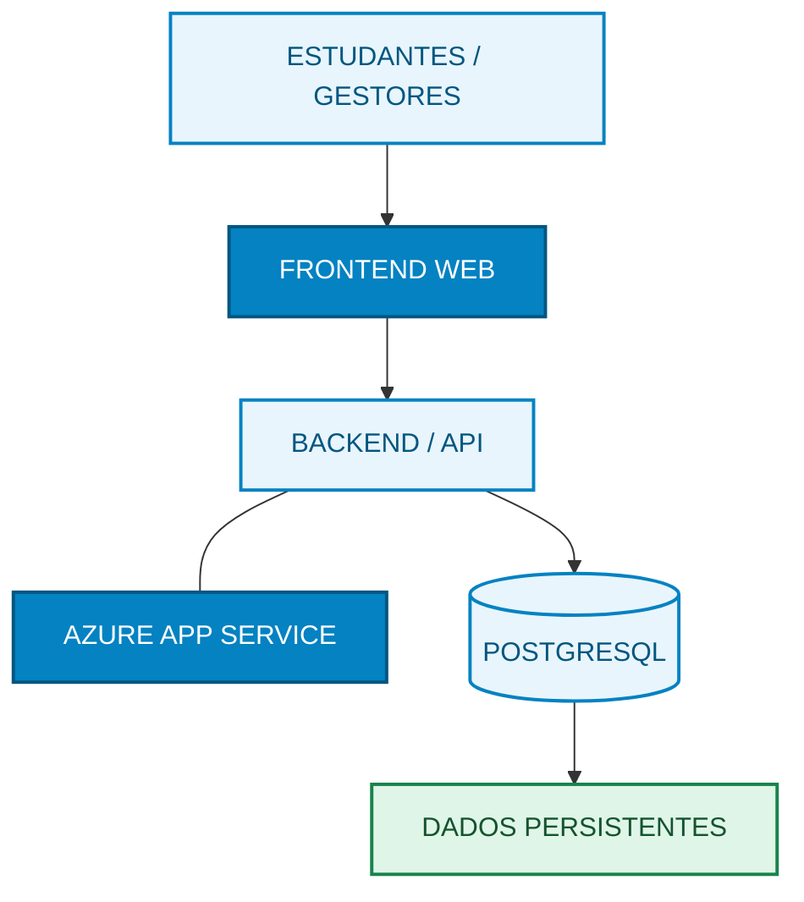

# Avalie o Atendimento
### Cloud Challenge — Grupo 1 | SENAC 2026.2

**Disciplina:** Cloud Computing  
**Professor:** Roni Maciel  
**Desafio:** 13 — Avalie o Atendimento  
**Complexidade:** Intermediária  
**Status:** 🟡 Planejamento  
**Repositório:** Já criado pela equipe

---

## 1. Apresentação do projeto

O projeto **Avalie o Atendimento** tem como objetivo desenvolver uma aplicação web para coletar, armazenar e apresentar avaliações anônimas dos serviços oferecidos por uma unidade educacional.

Atualmente, a instituição utiliza uma caixa de sugestões física, dificultando a organização das avaliações e a identificação de oportunidades de melhoria.

A solução permitirá que estudantes avaliem os serviços e que gestores acompanhem os resultados por meio de um painel de indicadores.

### Serviços avaliados

- Secretaria
- Biblioteca
- Cantina
- Laboratórios

### Regra central

O painel deverá apresentar a quantidade de avaliações, a distribuição das notas e a média por serviço.

**Serviços com menos de três avaliações deverão apresentar a mensagem "amostra insuficiente", sem exibir a média.**

---

## 2. Equipe e responsabilidades

| Integrante | Função | Responsabilidade |
|---|---|---|
| Antônio Enzo | DADOS | Modelagem do banco, tabelas e restrições |
| Emmanuel Luis | DADOS | Consultas SQL, cálculos e persistência |
| Everson José | NUVEM | Configuração Azure, deploy e monitoramento |
| Gabriel Eduardo | QA | Testes, evidências e documentação |
| José Allamberg | DEV | Backend, API e regras de negócio |
| Marcelo Barbosa | DEV | Frontend, dashboard e integração |

Todos os integrantes deverão compreender o funcionamento geral da aplicação e participar da apresentação.

---

## 3. Objetivos

### Objetivo geral

Desenvolver e disponibilizar uma aplicação web integrada a um banco de dados persistente, permitindo registrar avaliações anônimas e apresentar indicadores confiáveis de satisfação por serviço.

### Objetivos específicos

- Permitir avaliações anônimas.
- Validar notas entre 1 e 5.
- Permitir comentários opcionais de até 280 caracteres.
- Calcular médias com uma casa decimal.
- Apresentar a quantidade e a distribuição das avaliações.
- Identificar serviços com amostra insuficiente.
- Permitir moderação de comentários.
- Preservar avaliações após reiniciar a aplicação.
- Implantar a solução na infraestrutura Azure, conforme os recursos disponíveis.

---

## 4. Requisitos funcionais

| Código | Descrição | Prioridade |
|---|---|---|
| RF01 | Carregar serviços por script SQL inicial | Alta |
| RF02 | Registrar avaliação anônima com nota de 1 a 5 | Alta |
| RF03 | Exibir média, quantidade e distribuição das notas por serviço | Alta |
| RF04 | Exibir "amostra insuficiente" para menos de 3 avaliações | Crítica |
| RF05 | Ocultar comentários impróprios sem alterar a média | Alta |

### Requisitos técnicos

- Interface web ou API funcional.
- Persistência em banco de dados.
- Validação de entradas no servidor.
- Tratamento de erros HTTP.
- Rota `GET /health` com verificação da conexão ao banco.
- Consultas SQL parametrizadas.
- Credenciais armazenadas em variáveis de ambiente.
- Documentação e evidências no GitHub.

---

## 5. Arquitetura proposta

A arquitetura do sistema **Avalie o Atendimento** utiliza uma
aplicação web conectada a uma API, hospedada no Microsoft Azure,
com persistência de dados no PostgreSQL.

### Componentes

- **Estudantes e gestores:** usuários do sistema.
- **Frontend Web:** interface HTML, CSS e JavaScript.
- **Backend/API:** validações e regras de negócio.
- **Azure App Service:** hospedagem da aplicação.
- **PostgreSQL:** armazenamento das avaliações.
- **Dados persistentes:** histórico de avaliações e comentários.

### Tecnologias previstas

| Camada | Tecnologia sugerida |
|---|---|
| Frontend | HTML, CSS e JavaScript |
| Backend | Python ou Node.js, a definir |
| Banco de dados | PostgreSQL |
| Hospedagem | Azure App Service |
| Desenvolvimento | Visual Studio Code |
| Versionamento | Git e GitHub |
| Testes | Testes de API, integração e interface |

A escolha definitiva das tecnologias deverá considerar o domínio técnico da equipe, a disponibilidade dos serviços Azure e o prazo da atividade.

---

## 6. Planejamento do banco de dados

**Responsáveis:** Antônio Enzo e Emmanuel Luis.

### Tabela `servicos`

Campos previstos:

- `id`: identificador do serviço.
- `nome`: nome do serviço.

### Tabela `avaliacoes`

Campos previstos:

- `id`: identificador da avaliação.
- `servico_id`: referência ao serviço avaliado.
- `nota`: número inteiro entre 1 e 5.
- `comentario`: texto opcional com até 280 caracteres.
- `oculta`: indicador de moderação, padrão falso.
- `criada_em`: data e hora do registro.

### Atividades de DADOS

1. Criar o modelo relacional.
2. Definir chaves primárias e estrangeiras.
3. Implementar restrições de integridade.
4. Criar o script `schema.sql`.
5. Preparar os serviços iniciais.
6. Desenvolver consultas de agregação.
7. Validar médias e quantidades.
8. Comprovar persistência dos registros.

---

## 7. Planejamento de desenvolvimento

### Backend — José Allamberg

**Atividades previstas:**

1. Configurar a estrutura da aplicação.
2. Implementar conexão com o banco.
3. Criar endpoint de cadastro de avaliações.
4. Criar endpoint de consulta dos serviços.
5. Criar endpoint do painel de indicadores.
6. Implementar a regra de amostra insuficiente.
7. Implementar a moderação de comentários.
8. Validar dados recebidos.
9. Tratar erros HTTP.
10. Implementar a rota `/health`.

### Frontend — Marcelo Barbosa

**Atividades previstas:**

1. Definir a estrutura visual da aplicação.
2. Criar formulário de avaliação.
3. Criar seleção de serviço.
4. Implementar seleção de notas.
5. Criar campo opcional de comentário.
6. Integrar formulário à API.
7. Desenvolver painel de indicadores.
8. Exibir médias e distribuição de notas.
9. Exibir a mensagem "amostra insuficiente".
10. Criar interface de moderação.
11. Garantir responsividade para computadores e smartphones.

---

## 8. Planejamento de infraestrutura

**Responsável:** Everson José.

### Atividades previstas

1. Verificar a assinatura Azure autorizada.
2. Definir o nível de implantação.
3. Preparar os recursos necessários.
4. Configurar o Azure App Service.
5. Configurar o banco de dados.
6. Definir variáveis de ambiente.
7. Configurar `DATABASE_URL`.
8. Realizar o deploy.
9. Validar a rota `/health`.
10. Verificar logs e disponibilidade.
11. Registrar evidências do ambiente.
12. Encerrar recursos cobrados por hora, conforme as orientações do professor.

### Níveis de implantação

- **Nível A:** Aplicação e banco gerenciado na Azure.
- **Nível B:** Implantação parcial com banco compartilhado.
- **Nível C:** Execução local com plano de implantação documentado.

A meta inicial será o Nível A, desde que a infraestrutura esteja disponível e autorizada.

---

## 9. Planejamento de qualidade

**Responsável:** Gabriel Eduardo.

### Casos de teste obrigatórios

| Código | Cenário | Resultado esperado |
|---|---|---|
| CA01 | Enviar nota 0, 6 ou 3,5 | HTTP 400 |
| CA02 | Enviar comentário com 281 caracteres | HTTP 400 |
| CA03 | Registrar notas 5, 4 e 4 | Média 4,3 e quantidade 3 |
| CA04 | Serviço com duas avaliações | "Amostra insuficiente" |
| CA05 | Ocultar comentário | Comentário não aparece publicamente; média permanece igual |

### Testes complementares

- Verificar conexão com o banco.
- Validar dados após reinício da aplicação.
- Conferir os registros diretamente no banco.
- Testar campos obrigatórios.
- Verificar erros de serviço inexistente.
- Conferir mensagens de erro.
- Verificar integração frontend/backend.

### Evidências

Os testes deverão apresentar resultado esperado, resultado obtido e situação final.

---

## 10. Cronograma da atividade

| Horário | Etapa | Entrega |
|---|---|---|
| 18h00–18h45 | Abertura, orientações e distribuição | Equipe alinhada |
| 18h45–19h05 | Planejamento técnico | Arquitetura, modelo e tarefas |
| 19h05–20h05 | Sprint 1 — Persistência | Cadastro
