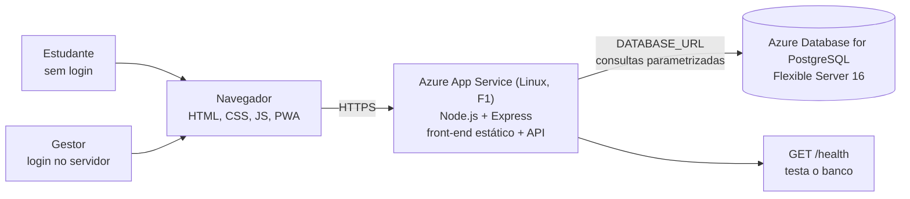

# Avalie o Atendimento

### Cloud Challenge — Grupo 1 | SENAC 2026.2

**Disciplina:** Cloud Computing · **Professor:** Roni Maciel · **Desafio:** 13, Avalie o Atendimento (intermediária)
**Repositório:** https://github.com/mbalbuquerque/avaliacao-de-atendimento
**Código do grupo:** `G01` (a palavra do dia, `G01-PALAVRA`, é anunciada pelo professor)

## 1. Problema e usuário

A unidade quer medir a satisfação com a secretaria, a biblioteca, a cantina e os laboratórios, mas hoje
só existe uma caixa de sugestões de papel que ninguém tabula. O **Avalie o Atendimento** deixa o estudante
avaliar um serviço de forma anônima (nota de 1 a 5 e comentário opcional) e mostra ao gestor médias
confiáveis por serviço: serviços com menos de 3 avaliações aparecem como "amostra insuficiente", em vez de
uma média enganosa. O gestor pode ocultar comentários impróprios sem alterar as notas.

**Usuários:** estudantes (avaliam, sem login) e gestores (consultam os indicadores e moderam).

## 2. Situação atual

| Item | Situação |
|---|---|
| API, regras de negócio e validação no servidor | **Implementadas e testadas** (30 de 30 testes passando na execução local) |
| Banco PostgreSQL: tabelas, restrições, serviços iniciais e 20 avaliações fictícias | **Implementado** (`banco/schema.sql`, `banco/dados-iniciais.sql`) |
| `GET /health` com teste real do banco | **Implementado e testado** |
| Moderação do gestor com autenticação no servidor | **API implementada e testada**; tela do gestor em integração |
| Integração do painel (formulário, dashboard) com a API | **Em andamento** (o painel ainda está em modo demonstração em `js/config.js`) |
| Implantação na Azure (App Service e PostgreSQL) | **PENDENTE** (recursos ainda não criados; roteiro em `docs/implantacao-azure.md`) |
| Evidências (prints da prova de persistência) e pitch de 90 s | **Pendentes** (lista e scripts em `evidencias/`) |

Nível de implantação: a meta é o **Nível A**. Se a infraestrutura bloquear por 15 minutos, o grupo desce
para o Nível B ou C e registra o motivo no painel da turma.

## 3. Requisitos da ficha

| Código | Requisito | Status |
|---|---|---|
| RF01 | Carregar os quatro serviços por script SQL inicial | **Pronto.** `banco/schema.sql` insere Secretaria, Biblioteca, Cantina e Laboratórios; teste `RF01` |
| RF02 | Registrar avaliação anônima com nota inteira de 1 a 5 e comentário opcional de até 280 caracteres | **API pronta e testada** (`POST /api/avaliacoes`). Formulário do painel: integração em andamento |
| RF03 | Painel por serviço: média com 1 casa, quantidade e distribuição das notas, calculadas no banco | **API pronta e testada** (`GET /api/indicadores`, agregação em SQL). Dashboard: integração em andamento |
| RF04 | Menos de 3 avaliações mostra "amostra insuficiente" no lugar da média (regra central) | **Pronto e testado** (`media: null`, `amostra_suficiente: false`) |
| RF05 | Moderação: o gestor oculta comentário; a nota continua contando (regra central) | **API pronta e testada** (`PATCH /api/admin/avaliacoes/{id}`). Tela do gestor: integração em andamento |

Regras detalhadas e casos de aceite: [docs/regras-de-negocio.md](docs/regras-de-negocio.md).
Contrato das rotas: [docs/contrato-api.md](docs/contrato-api.md). Requisições prontas: [requests.http](requests.http).

## 4. Arquitetura



O navegador carrega as páginas e chama a API no **mesmo endereço**. A API valida tudo no servidor, grava no
PostgreSQL e calcula os indicadores no banco. A string de conexão vem só da variável de ambiente
`DATABASE_URL`. A implantação na Azure ainda está pendente (ver seção 2).

### Decisão justificada: PostgreSQL relacional, com a média calculada no SQL

**Escolha:** guardar as avaliações em PostgreSQL (duas tabelas ligadas por chave estrangeira) e calcular
quantidade, distribuição e média com `COUNT`, `AVG` e `ROUND` no próprio banco, em vez de usar um banco
NoSQL (como o Table Storage) e somar na aplicação.

**O que se ganha:**
- O banco impede dado inválido sozinho: `CHECK (nota BETWEEN 1 AND 5)`, `VARCHAR(280)` e chave
  estrangeira para o serviço. Mesmo uma chamada que fure a validação da API não grava lixo (há teste
  provando isso).
- A regra central fica numa consulta só (`ROUND(AVG(nota)::numeric, 1)` por serviço), exata e
  fácil de conferir à mão: notas 5, 4 e 4 dão 4,3.
- A moderação é só `UPDATE ... SET oculta`; como a nota nunca é apagada, o indicador não muda.

**O que se perde:**
- Custo: o servidor PostgreSQL gerenciado cobra por hora e precisa ser parado ao fim da aula, enquanto o
  Table Storage custa quase nada.
- Simplicidade e escala: há um servidor para configurar (firewall, TLS, `DATABASE_URL`); um NoSQL
  escalaria mais fácil, mas perderia restrições e agregações prontas.

## 5. Modelo de dados

Arquivo completo: [banco/schema.sql](banco/schema.sql).

```sql
CREATE TABLE IF NOT EXISTS servicos (
  id   SMALLSERIAL PRIMARY KEY,
  nome VARCHAR(60) NOT NULL UNIQUE
);

CREATE TABLE IF NOT EXISTS avaliacoes (
  id          SERIAL PRIMARY KEY,
  servico_id  SMALLINT    NOT NULL REFERENCES servicos (id),
  nota        SMALLINT    NOT NULL CHECK (nota BETWEEN 1 AND 5),
  comentario  VARCHAR(280),
  oculta      BOOLEAN     NOT NULL DEFAULT false,
  criada_em   TIMESTAMPTZ NOT NULL DEFAULT now()
);

CREATE INDEX IF NOT EXISTS idx_avaliacoes_servico ON avaliacoes (servico_id);
```

| Restrição | Onde | Para quê |
|---|---|---|
| `PRIMARY KEY` em `id` | as duas tabelas | identificar cada linha |
| `UNIQUE (nome)` | `servicos` | sem serviço duplicado |
| `NOT NULL` em `nota`, `servico_id`, `oculta`, `criada_em` | `avaliacoes` | campos obrigatórios |
| `CHECK (nota BETWEEN 1 AND 5)` | `avaliacoes` | só notas válidas, direto no banco |
| `VARCHAR(280)` | `comentario` | limite do comentário |
| `FOREIGN KEY servico_id → servicos.id` | `avaliacoes` | só avalia serviço que existe |
| `TIMESTAMPTZ` | `criada_em` | guarda o fuso (o App Service roda em UTC) |

Anonimato: não existe nome, e-mail, matrícula nem identificador do estudante em nenhuma tabela. O limite
contra abuso usa o IP só na memória, por 1 minuto, sem gravar em disco nem no banco.

## 6. Como executar

**Requisitos:** Node.js 20 ou mais novo. Para rodar com dados reais, um PostgreSQL (local ou o da Azure).
Os testes **não** precisam de banco instalado.

```bash
npm install                          # dependências (express e pg)
cp .env.example .env                 # preencha com valores seus; o .env NUNCA vai para o Git
npm run hash -- "senha-do-gestor"    # imprime o hash scrypt para ADMIN_SENHA_HASH
npm run banco -- --dados             # cria as tabelas e carrega as 20 avaliações fictícias
npm run dev                          # sobe em http://localhost:3000 lendo o .env
npm start                            # igual, sem ler o .env (o ambiente já tem as variáveis)
npm test                             # roda os 30 testes
```

| Variável | Para quê |
|---|---|
| `DATABASE_URL` | String de conexão do PostgreSQL (com `?sslmode=require` na Azure) |
| `PORT` | Porta local (na Azure o App Service define sozinho) |
| `ADMIN_USUARIO` | Usuário do gestor |
| `ADMIN_SENHA_HASH` | Hash scrypt da senha do gestor (gerado por `npm run hash`) |
| `SESSAO_SEGREDO` | Segredo de 32 caracteres ou mais que assina a sessão do gestor |

Sem `DATABASE_URL` a aplicação sobe, mas as rotas de dados e o `/health` respondem **503**. Sem as
variáveis do gestor o login responde 503 e nunca libera o acesso.

Páginas: `/` (avaliar), `/dashboard.html` (indicadores), `/admin-login.html` e `/admin.html` (moderação).
As requisições da API estão em [requests.http](requests.http).

### Nível C (local) e plano de implantação na Azure

Se a Azure não estiver disponível, o produto roda no computador (banco PostgreSQL local, mesmas
variáveis de ambiente) com demonstração e prints. O plano completo de implantação, com todos os comandos
`az`, está em [docs/implantacao-azure.md](docs/implantacao-azure.md): grupo `rg-cloud-g01`, App Service
Linux F1 (`app-cloud-g01-INICIAIS`), PostgreSQL Flexible Server 16 Burstable B1ms, configuração por
variáveis de ambiente, deploy, reinício, logs, parada do servidor e exclusão do grupo.

## 7. Casos de teste

Todos executados com `npm test`, contra um **PostgreSQL de verdade em memória (PGlite)** que usa o mesmo
`banco/schema.sql` da produção. Resultado na execução local: **30 de 30 passaram** (arquivo
[tests/api.test.js](tests/api.test.js)). Os casos CA1, CA2 e as entradas inválidas são negativos.

| # | Caso | Esperado | Resultado |
|---|---|---|---|
| 1 | RF01: serviços iniciais | Secretaria, Biblioteca, Cantina e Laboratórios | PASS |
| 2 | **CA1 (negativo):** nota 0, 6, 3.5, -1, texto, nula ou ausente | HTTP 400 e nada gravado | PASS |
| 3 | CA1: notas 1 a 5 | HTTP 201 com `id` | PASS |
| 4 | **CA2 (negativo):** comentário de 281 caracteres | HTTP 400; com 280 é aceito (201) | PASS |
| 5 | CA2: conta caracteres, não bytes (acento e emoji valem 1) | 280 aceitos; 281 emojis recusados | PASS |
| 6 | **CA3:** notas 5, 4 e 4 | quantidade 3, média 4,3, distribuição `{4: 2, 5: 1}` | PASS |
| 7 | **CA4:** duas avaliações | `media: null`, `amostra_suficiente: false` | PASS |
| 8 | CA4: serviço sem avaliação | quantidade 0 e média nula | PASS |
| 9 | **CA5:** ocultar comentário | some da lista pública; quantidade, média e distribuição iguais; reexibir devolve | PASS |
| 10 | Serviço inexistente | HTTP 404 | PASS |
| 11 | Avaliação inexistente na moderação | HTTP 404 | PASS |
| 12 | Rota desconhecida da API | HTTP 404 em JSON | PASS |
| 13 | JSON malformado | HTTP 400 sem detalhe interno | PASS |
| 14 | Banco fora do ar | HTTP 503 em todas as rotas de dados e no `/health`, sem expor host, senha ou erro do driver | PASS |
| 15 | `/health` | 200, `connected` e `iniciado_em` | PASS |
| 16 | Persistência após reinício | `iniciado_em` muda e o registro continua lá | PASS |
| 17 | Restrições do banco | `CHECK`, `VARCHAR(280)` e chave estrangeira recusam dado inválido sem passar pela API | PASS |
| 18 | Injeção de SQL no comentário | gravada como texto, tabela intacta | PASS |
| 19 | Moderação sem login ou com cookie falso | HTTP 401 | PASS |
| 20 | Login com senha ou usuário errados | HTTP 401 com a mesma mensagem | PASS |
| 21 | Login correto | cookie `HttpOnly` e `SameSite=Strict`; libera a moderação | PASS |
| 22 | Logout | cookie apagado | PASS |
| 23 | Moderação com `Origin` de outro site | HTTP 403 | PASS |
| 24 | Moderação com corpo ou id inválido | HTTP 400 | PASS |
| 25 | Lista do gestor | traz os ocultos; a pública não | PASS |
| 26 | Cabeçalhos | `Cache-Control: no-store` e `nosniff` nas respostas da API | PASS |
| 27 | Arquivos do servidor | `/server.js`, `/.env`, `/banco/schema.sql`, `/src/app.js` e `/.git/config` retornam 404 | PASS |
| 28 | Sem `DATABASE_URL` | rotas de dados e `/health` em 503; front continua no ar | PASS |
| 29 | Sem variáveis do gestor | login responde 503 | PASS |
| 30 | Dados iniciais | 20 avaliações; Laboratórios com amostra insuficiente | PASS |

A validação demonstrativa do painel não substitui estes testes: as entradas inválidas são enviadas
direto à API para provar a validação no servidor. O CI (`.github/workflows/ci.yml`) roda a mesma suíte a
cada push e pull request.

## 8. Segurança e configuração

- String de conexão e segredos só em variáveis de ambiente; `.env` no `.gitignore`; `.env.example` só com
  nomes e valores falsos.
- Consultas SQL sempre parametrizadas (`$1`, `$2`...); há teste de injeção.
- Validação de nota, serviço e comentário no servidor; erros sem detalhe interno (400, 404, 429, 503).
- Moderação protegida no servidor: senha com hash `scrypt`, sessão assinada (HMAC-SHA256) em cookie
  `HttpOnly` + `SameSite=Strict`, bloqueio de `Origin` de outro site e limite de tentativas de login.
- O servidor só entrega as pastas do front-end (`css`, `js`, `icons`) e as páginas listadas; o restante do
  repositório nunca é servido.
- Somente dados fictícios.

## 9. Dificuldade superada

> **A preencher pelo grupo com a dificuldade real** (problema, diagnóstico, causa e solução). A ficha
> pede um caso que realmente aconteceu na construção; não foi registrado nenhum aqui para não inventar.

## 10. Limitações conhecidas e próximos passos

**Limitações:**
- Implantação na Azure pendente: ainda não há URL pública, prints de persistência nem teste do professor.
- Integração do painel (formulário, dashboard e tela do gestor) com a API em andamento; o modo
  demonstração (`localStorage`) continua existindo no código do front-end.
- Um único gestor, definido por variáveis de ambiente (sem cadastro de gestores).
- O limite contra abuso é em memória e por instância: reiniciar ou ter mais de uma instância zera a
  contagem. Isso protege o anonimato, mas é um controle simples.
- Qualquer pessoa pode enviar avaliações (não há como provar que o autor é estudante sem identificá-lo).
- Os testes usam PGlite (PostgreSQL em memória); ainda não foram executados contra o PostgreSQL da Azure.

**Próximos passos:** criar os recursos na Azure e registrar a prova de persistência; terminar a integração
do painel; gravar o pitch de 90 segundos; preencher a seção de dificuldade superada; adicionar o
`GXX-PALAVRA` do dia nas evidências.

## 11. Equipe e responsabilidades

| Integrante | Função | Responsabilidade |
|---|---|---|
| Antônio Enzo | DADOS | Modelagem do banco, tabelas e restrições |
| Emmanuel Luis | DADOS | Consultas SQL, cálculos e persistência |
| Everson José | NUVEM | Configuração Azure, deploy e monitoramento |
| Gabriel Eduardo | QA | Testes, evidências e documentação |
| José Allamberg | DEV | Backend, API e regras de negócio |
| Marcelo Barbosa | DEV | Frontend, dashboard e integração |

Todos os integrantes devem saber explicar o fluxo completo da aplicação.

## 12. Estrutura do repositório

```
.
├── README.md
├── .env.example              nomes das variáveis (valores falsos)
├── .gitignore                inclui .env e node_modules
├── package.json              dependências e scripts (start, dev, test, banco, hash)
├── server.js                 ponto de entrada
├── src/                      API: rotas (app.js), banco (db.js), validação e autenticação
├── banco/
│   ├── schema.sql            tabelas, restrições e serviços iniciais
│   └── dados-iniciais.sql    20 avaliações fictícias
├── scripts/                  preparar o banco e gerar o hash da senha do gestor
├── tests/                    testes automatizados (CA1 a CA5 e demais)
├── evidencias/               prints (E1 a E6) e scripts da prova de persistência
├── docs/                     contrato da API, regras de negócio e implantação na Azure
├── requests.http             requisições prontas (REST Client)
├── .github/workflows/ci.yml  testes a cada push
└── index.html, dashboard.html, admin*.html, css/, js/, icons/, sw.js    front-end (PWA)
```
