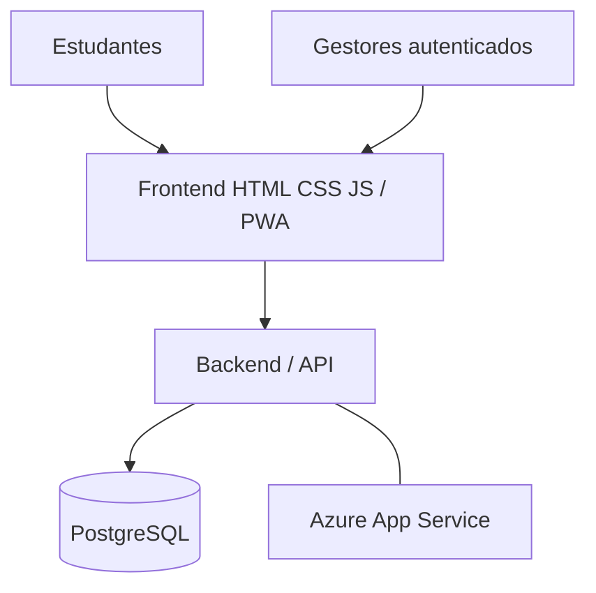

# Avalie o Atendimento

### Cloud Challenge — Grupo 1 | SENAC 2026.2

**Disciplina:** Cloud Computing  
**Professor:** Roni Maciel  
**Desafio:** 13 — Avalie o Atendimento  
**Complexidade:** Intermediária  
**Status:** 🟡 Frontend demonstrativo implementado; integração com backend, PostgreSQL e Azure pendente de validação  
**Repositório:** https://github.com/mbalbuquerque/avaliacao-de-atendimento

## 1. Apresentação

O **Avalie o Atendimento** é uma aplicação web para coletar avaliações de serviços de uma unidade educacional sem exigir cadastro ou login dos estudantes. Substitui o processo informal de sugestões físicas por registros estruturados e indicadores de satisfação. Os gestores poderão moderar comentários inadequados, sem alterar a contagem ou as notas das avaliações.

**Serviços avaliados:** Secretaria, Biblioteca, Cantina e Laboratórios.

> **Regra central:** o painel apresenta quantidade, distribuição das notas de 1 a 5 e média por serviço. Quando um serviço tem menos de três avaliações, deve mostrar **“Amostra insuficiente”** e não divulgar sua média.

## 2. Situação atual

| Entrega | Estado |
|---|---|
| Formulário de avaliação sem cadastro de estudante | Implementado no frontend |
| Seleção de serviço, estrelas de 1 a 5 e comentário opcional | Implementado no frontend |
| Validação de interface e contador de 280 caracteres | Implementado no frontend |
| Indicadores, dashboard e comentários | Funcionando em modo demonstração |
| Ocultar/reexibir comentários sem retirar a nota dos indicadores | Testado no modo demonstração (CA05 local) |
| Interface responsiva e recursos PWA | Implementados; revisar cache no deploy |
| Tela de login administrativo | Interface demonstrativa; **sem autenticação real** |
| API, autenticação, PostgreSQL e persistência compartilhada | **Integração pendente** |
| Testes CA01–CA05 contra API real e deploy Azure | **Pendentes de validação** |

No modo `demo`, as avaliações são armazenadas no `localStorage` do navegador. Elas **não são compartilhadas entre dispositivos**, não constituem persistência no PostgreSQL e podem ser perdidas quando os dados do navegador forem apagados.

## 3. Equipe e responsabilidades

| Integrante | Função | Responsabilidade |
|---|---|---|
| Antônio Enzo | DADOS | Modelagem do banco, tabelas e restrições |
| Emmanuel Luis | DADOS | Consultas SQL, cálculos e persistência |
| Everson José | NUVEM | Configuração Azure, deploy e monitoramento |
| Gabriel Eduardo | QA | Testes, evidências e documentação |
| José Allamberg | DEV | Backend, API e regras de negócio |
| Marcelo Barbosa | DEV | Frontend, dashboard e integração |

Todos os integrantes deverão compreender o funcionamento geral da aplicação e participar da apresentação.

## 4. Objetivos e requisitos

**Objetivo geral:** disponibilizar uma aplicação web integrada a um banco de dados persistente, capaz de registrar avaliações sem identificação do estudante e apresentar indicadores confiáveis de satisfação por serviço.

**Objetivos específicos:** registrar notas válidas; aceitar comentários opcionais; calcular médias com uma casa decimal; apresentar quantidade e distribuição das notas; sinalizar amostras insuficientes; moderar comentários; preservar dados após reinício da aplicação; e implantar a solução na Azure conforme os recursos disponíveis.

| Código | Requisito funcional | Prioridade |
|---|---|---|
| RF01 | Carregar quatro serviços por script SQL inicial | Alta |
| RF02 | Registrar avaliação sem login, com nota inteira de 1 a 5 | Alta |
| RF03 | Exibir média, quantidade e distribuição das notas por serviço | Alta |
| RF04 | Exibir “Amostra insuficiente” com menos de 3 avaliações | Crítica |
| RF05 | Ocultar comentários impróprios sem alterar as estatísticas | Alta |

As regras detalhadas, incluindo RN01–RN12 e os casos de aceite, estão em **[docs/regras-de-negocio.md](docs/regras-de-negocio.md)**.

## 5. Arquitetura



**Arquitetura alvo:** navegador → frontend → backend/API hospedado no Azure App Service → PostgreSQL. A autenticação administrativa, as validações definitivas, as regras de negócio e a persistência devem ser executadas no servidor. O frontend não substitui essas garantias.

| Camada | Tecnologia |
|---|---|
| Frontend | HTML, CSS e JavaScript |
| PWA | Manifest, service worker e página offline |
| Backend | Python ou Node.js — decisão da equipe pendente de confirmação |
| Banco | PostgreSQL — integração pendente |
| Nuvem | Azure App Service — implantação pendente |
| Ferramentas | Visual Studio Code, Git e GitHub |
| QA | Testes de interface, API, integração e persistência |

## 6. Estrutura do frontend

| Arquivo | Responsabilidade |
|---|---|
| `index.html` | Página pública e formulário de avaliação |
| `dashboard.html` | Visualização dos indicadores |
| `admin-login.html` | Interface de acesso administrativo |
| `admin.html` | Interface de moderação |
| `css/style.css` | Estilo da página principal |
| `css/dashboard.css` | Estilo do dashboard |
| `css/admin.css` | Estilo da moderação |
| `css/admin-login.css` | Estilo do login |
| `js/config.js` | Seleção de modo e endereço da API |
| `js/api.js` | Camada de comunicação com a API |
| `js/script.js` | Interações da página inicial |
| `js/dashboard.js` | Indicadores e gráficos |
| `js/admin.js` | Moderação demonstrativa |
| `js/admin-login.js` | Fluxo da interface de login |
| `manifest.webmanifest`, `sw.js`, `offline.html` | Recursos PWA e comportamento offline |
| `docs/` | Contrato de API e regras de negócio |

Os arquivos devem ser conferidos com a árvore atual do repositório antes da entrega.

## 7. Como executar localmente

Requisitos: navegador atualizado e Python disponível no terminal.

```powershell
# Na pasta raiz do repositório
python -m http.server 5500
```

Acesse:

- Página inicial: http://localhost:5500/index.html
- Dashboard: http://localhost:5500/dashboard.html
- Login demonstrativo: http://localhost:5500/admin-login.html
- Moderação demonstrativa: http://localhost:5500/admin.html

Em `js/config.js`, mantenha o modo demonstrativo enquanto a API não estiver disponível:

```javascript
window.APP_CONFIG = Object.freeze({
  mode: "demo",
  apiBaseUrl: "/api",
  requestTimeout: 10000
});
```

**Atenção:** trocar para `mode: "api"` não implementa nem habilita o backend. Antes da troca, é necessário validar a URL, os formatos JSON, os endpoints, o tratamento de erros e as regras de autenticação. O modo demo não oferece segurança administrativa.

## 8. Contrato de API proposto

Os endpoints abaixo representam o **contrato planejado** e dependem de confirmação e implementação pelo responsável pelo backend.

| Método | Rota | Finalidade |
|---|---|---|
| GET | `/api/servicos` | Listar serviços |
| POST | `/api/avaliacoes` | Registrar nota e comentário |
| GET | `/api/indicadores` | Obter indicadores por serviço |
| GET | `/api/comentarios` | Obter comentários públicos |
| POST | `/api/admin/login` | Autenticar gestor |
| GET | `/api/admin/me` | Consultar sessão/permissão |
| GET | `/api/admin/avaliacoes` | Consultar avaliações para moderação |
| PATCH | `/api/admin/avaliacoes/{id}` | Ocultar ou reexibir comentário |
| POST | `/api/admin/logout` | Encerrar sessão |
| GET | `/health` | Verificar aplicação e conexão com banco |

Exemplo de payload proposto para avaliação:

```json
{
  "servico_id": 1,
  "nota": 5,
  "comentario": "Atendimento excelente."
}
```

Consulte também `docs/contrato-api.md`, caso presente no repositório. Nomes de campos e formatos de resposta devem ser alinhados entre frontend e backend antes da integração.

## 9. Modelo de dados planejado

**Responsáveis:** Antônio Enzo e Emmanuel Luis.

**`servicos`:** `id`, `nome`.

**`avaliacoes`:** `id`, `servico_id` (FK), `nota` (inteiro de 1 a 5), `comentario` (opcional, até 280 caracteres), `oculta` (booleano, padrão falso), `criada_em` (data/hora).

Atividades previstas: criar `schema.sql`; estabelecer chaves, restrições e integridade referencial; inserir os quatro serviços e a carga inicial de testes; elaborar agregações; e comprovar persistência após reiniciar a aplicação.

## 10. Testes e critérios de aceite

**Responsável:** Gabriel Eduardo, com apoio da equipe.

| Código | Cenário | Resultado esperado |
|---|---|---|
| CA01 | Enviar nota 0, 6 ou 3,5 | HTTP 400 |
| CA02 | Enviar comentário com 281 caracteres | HTTP 400 |
| CA03 | Registrar notas 5, 4 e 4 | Quantidade 3 e média 4,3 |
| CA04 | Serviço com duas avaliações | “Amostra insuficiente”, sem média pública |
| CA05 | Ocultar comentário | Comentário não aparece publicamente; nota e média permanecem |

A validação demonstrativa de CA05 **não substitui** o teste contra API e PostgreSQL. Os casos CA01 e CA02 devem ser enviados diretamente à API para comprovar validação no servidor, mesmo que o navegador também impeça entradas inválidas.

**Evidências a registrar:** entradas utilizadas, resultado esperado, resultado obtido, código HTTP, capturas ou logs, situação PASS/FAIL e persistência após reinício.

## 11. Infraestrutura e implantação

**Responsável:** Everson José.

- Verificar assinatura Azure autorizada e orçamento.
- Configurar Azure App Service e PostgreSQL conforme recursos disponíveis.
- Manter `DATABASE_URL` e outras credenciais em variáveis de ambiente.
- Configurar conexão segura e validar `GET /health` com acesso ao banco.
- Verificar logs, disponibilidade e persistência.
- Registrar evidências de implantação e encerrar recursos cobrados por hora, quando aplicável.

**Níveis de implantação definidos no planejamento original:**

- **Nível A:** aplicação e banco gerenciado na Azure.
- **Nível B:** implantação parcial com banco compartilhado.
- **Nível C:** execução local com plano de implantação documentado.

A meta é o Nível A, condicionada à infraestrutura autorizada.

## 12. Segurança e privacidade

- O estudante não precisa criar conta nem informar nome, e-mail ou matrícula.
- Evitar dados pessoais no campo de comentário; revisar tratamento de logs e dados técnicos no backend.
- Validar nota, serviço e comprimento do comentário **no servidor**.
- Não expor senhas, tokens ou segredos no JavaScript ou no Git.
- Exigir autenticação e autorização do gestor em **todos** os endpoints administrativos.
- Adotar HTTPS, sessões seguras e proteção CSRF quando aplicável.
- Ocultar um comentário **não** deve excluir a avaliação nem alterar seus indicadores.
- O login demonstrativo não é mecanismo de segurança de produção.

## 13. Organização e acompanhamento

As atividades devem ser registradas como **GitHub Issues** e acompanhadas por um **GitHub Project** com estados *A fazer*, *Em andamento* e *Concluído*. Priorizar: contrato de API, PostgreSQL, integração, autenticação, testes CA01–CA05 e deploy.

## 14. Cronograma acadêmico

O README original apresentava as seguintes etapas:

| Horário | Etapa | Entrega |
|---|---|---|
| 18h00–18h45 | Abertura, orientações e distribuição | Equipe alinhada |
| 18h45–19h05 | Planejamento técnico | Arquitetura, modelo e tarefas |
| 19h05–20h05 | Sprint 1 — Persistência | **Descrição interrompida no arquivo original** |

O restante do cronograma deve ser recuperado do material acadêmico original antes de ser documentado como fato.

---

**Documentação complementar:** [Regras de negócio](docs/regras-de-negocio.md) · `docs/contrato-api.md` (se presente).
